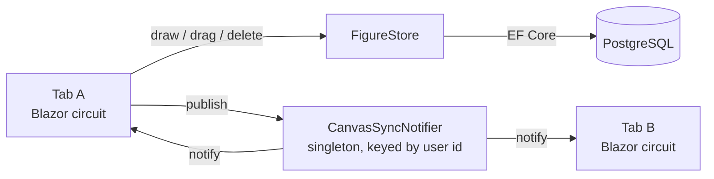

# BlazorCanvas

A drawing canvas built with Blazor Server and PostgreSQL. You log in, draw simple figures, and every
other browser tab you have open shows the same canvas live, including a figure moving in real time
while you drag it in another tab.

<!-- TODO: add docs/demo.gif (two browser windows side by side, dragging a figure) and show it here:
 -->

## Features

- **Four figures:** line, rectangle, circle and triangle, drawn on a fixed 1472 × 828 SVG canvas with a live preview.
- **Three actions:** draw, drag and delete. There is no Save button; each action is written to PostgreSQL immediately.
- **Live sync between tabs:** changes made in one tab appear in the user's other tabs, including each step of a drag.
- **One canvas per user:** a user only ever loads and receives their own figures.
- **Login with a session cookie:** an unknown username is registered on first login.

The scope is small on purpose. Resize, rotate, undo, colours, zoom and export are out of scope.

## Tech stack

| Area | Technology |
|---|---|
| Runtime | .NET 10, C# |
| UI | Blazor Server (interactive server components), SVG |
| Data | PostgreSQL 17, Entity Framework Core 10, Npgsql |
| Auth | ASP.NET Core cookie authentication |
| Tests | xUnit |
| Local infrastructure | Docker Compose (PostgreSQL only) |

## How it works



- **Each tab is its own Blazor Server circuit** with its own dependency-injection scope. To reach other
  tabs, changes go through `CanvasSyncNotifier`, which is registered as a singleton and shared by all circuits.
- **Subscribers are grouped by user id.** A publish for one user only looks up that user's group, so
  another user's tabs can never receive it.
- **The sender also receives its own message** and ignores it using a per-tab id. The notifier does not
  need to know which subscription belongs to which tab.
- **Database access uses `IDbContextFactory`**, not a scoped `DbContext`. A circuit lives as long as the
  tab is open, so a scoped context would keep tracking entities for hours and fail when two handlers overlap.
  Every operation creates and disposes its own short-lived context.
- **The database enforces the rules too.** Figure coordinates and types are guarded by `CHECK` constraints
  in PostgreSQL, and the tests insert invalid rows directly to prove the database refuses them.
- **Migrations are applied at startup**, with retries while the database container is still starting.

Design decisions are recorded in [docs/DECISIONS.md](docs/DECISIONS.md).

## Run locally

Requirements: [.NET 10 SDK](https://dotnet.microsoft.com/download) and Docker.

```bash
git clone https://github.com/YahorHurski/BlazorCanvas.git
cd BlazorCanvas

# Start PostgreSQL (published on host port 5433)
docker compose up -d

# Start the app; migrations run automatically
dotnet run --project src/BlazorCanvas
```

Open http://localhost:5054, enter any username and password to create an account, and draw.
To see the sync, open the same address in a second window and log in as the same user.

## Tests

```bash
docker compose up -d   # the database tests need PostgreSQL
dotnet test
```

The suite has 115 test methods (405 cases):

- **Geometry:** coordinate conversion, clamping to the canvas edges, minimum size, normalisation.
- **Sync:** delivery to all of a user's subscribers, isolation between users, unsubscribe.
- **Database:** schema shape and `CHECK` constraints, run against the real PostgreSQL container.

Without the container, the 84 database cases fail with a message telling you to start it; the rest pass.
Set `BLAZORCANVAS_TEST_CONNECTION` to run the database tests against a different PostgreSQL instance.

## Project structure

```
src/BlazorCanvas/
  Auth/         username normalisation
  Components/   pages (Home, Login), canvas components, layout
  Data/         EF Core context, entities, FigureStore
  Geometry/     pure geometry rules (no UI or database dependencies)
  Sync/         CanvasSyncNotifier and message types
  Migrations/   EF Core migrations
tests/BlazorCanvas.Tests/
docs/DECISIONS.md
```

## Known limitations

This is a learning project, and some shortcuts are deliberate:

- **Passwords are stored in plain text.** Do not reuse a real password. Hashing them is the first thing to fix.
- **Sync works within one server process.** The notifier is in memory, so running several instances
  would need a backplane such as PostgreSQL `LISTEN/NOTIFY` or Redis.
- **Only the database runs in Docker.** There is no Dockerfile for the app, no CI workflow and no hosted demo yet.
